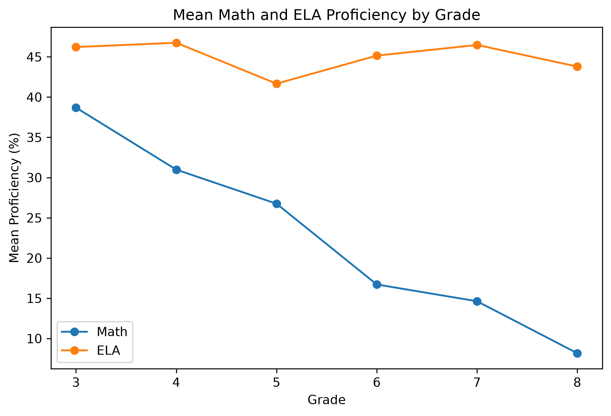

# Maryland Public School MCAP Proficiency Analysis

This project examines Math and English Language Arts (ELA) proficiency across grades 3–8 in Maryland public schools from 2023–2025. It explores how proficiency varies by subject, grade, and year, as well as its relationship with chronic absenteeism and school-level student characteristics.

The analysis uses four publicly available datasets, combining Math and ELA MCAP assessment results with school attendance and student characteristics data. After cleaning and integration, the resulting dataset contains **22,102 school-year-grade-subject records**.

## Key Findings

- **ELA proficiency was higher than Math proficiency across all grades**, with the gap widening substantially in grades 6–8. Average ELA proficiency remained around 42–47%, while grade-level Math proficiency declined from approximately 39% in grade 3 to 8% in grade 8.
- **Chronic absenteeism and economic disadvantage were negatively associated with proficiency.** In the core regression model, a one-percentage-point increase in chronic absenteeism was associated with an estimated 0.28-percentage-point decrease in proficiency, holding other variables constant. The corresponding estimate for Free and Reduced-Price Meals (FARMS) was 0.59 percentage points.
- **Additional student characteristics were examined in an extended model.** A higher percentage of multilingual learners was significantly associated with lower proficiency, although this model used a smaller sample due to missing data.

These findings describe associations rather than causal relationships. Grade-level Math results for grades 6–8 should also be interpreted cautiously because some students take course-based Math assessments instead.



*Mean Math and ELA MCAP proficiency by grade, 2023–2025.*

📄 [**Read the full project report (PDF)**](Maryland_MCAP_Analysis_Report.pdf)

## Repository Structure

```text
.
├── data/
│   ├── raw/
│   │   ├── 2023/
│   │   ├── 2024/
│   │   └── 2025/
│   └── processed/
│       ├── analysis_ready_2023_2025.csv
│       ├── attendance_2023_2025.csv
│       ├── mcap_ela_2023_2025.csv
│       ├── mcap_math_2023_2025.csv
│       ├── special_services_2023_2025.csv
│       └── maryland_education.db
├── figures/
│   ├── mean_proficiency_by_grade_subject.png
│   ├── proficiency_vs_chronic_absenteeism.png
│   └── proficiency_vs_farms.png
├── notebooks/
│   ├── 01_data_preparation.ipynb
│   ├── 02_data_integration_sql.ipynb
│   ├── 03_exploratory_data_analysis.ipynb
│   └── 04_regression_analysis.ipynb
├── .gitignore
├── Maryland_MCAP_Analysis_Report.pdf
└── README.md
```

The four notebooks document the analysis workflow, from preparing the source data and integrating the datasets using SQL to exploratory analysis and regression modeling. The `data/` directory contains the original and processed datasets, while `figures/` contains the visualizations used in the report.

## Tools and Methods

Python was used for data preparation, visualization, and statistical analysis, while SQL (SQLite) was used to integrate the cleaned datasets. The analysis included exploratory data analysis, correlation analysis, and ordinary least squares (OLS) regression.

## Data Sources

The analysis uses publicly available Maryland public school data from 2023–2025, including Math MCAP results, ELA MCAP results, school attendance, and student characteristics. The original source files are included in `data/raw/`, organized by year.

Additional information about data preparation, assessment suppression, modeling decisions, and limitations is provided in the project report and notebooks.
